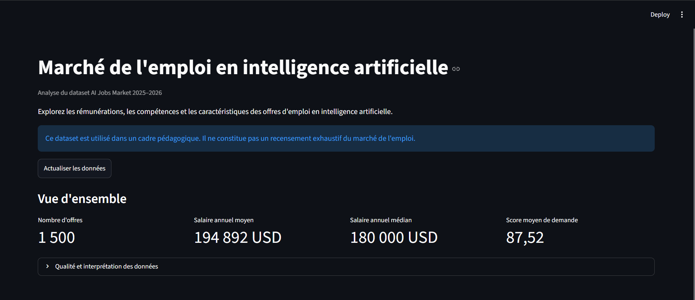
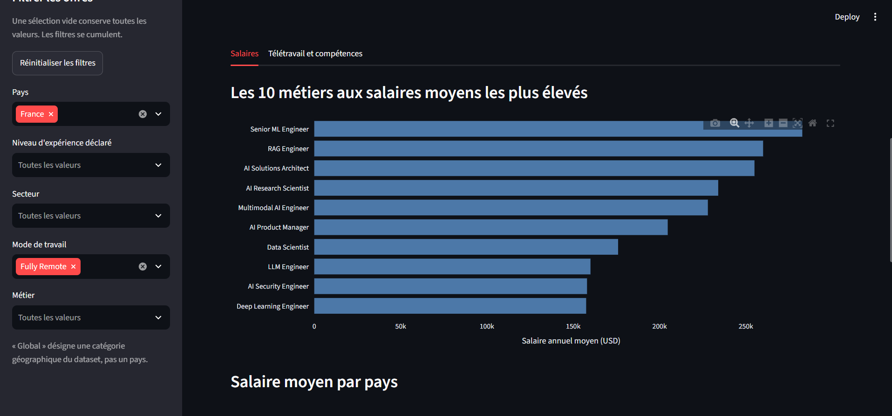
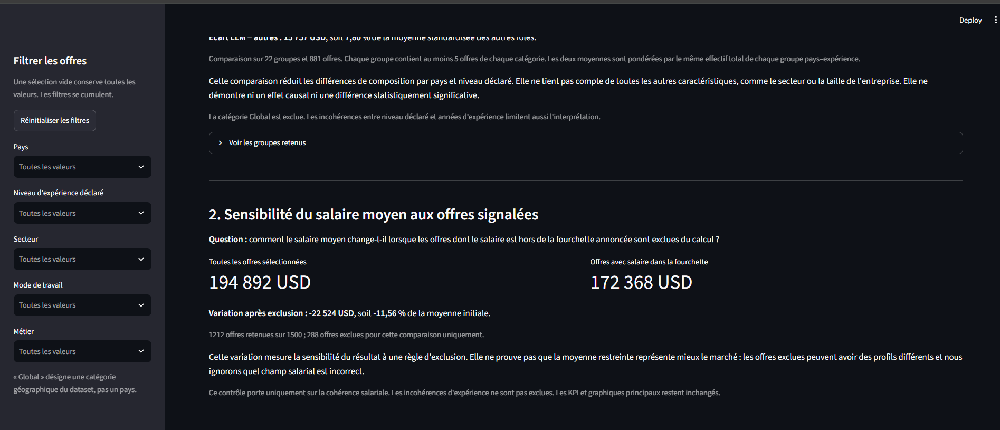

# Application conteneurisée d’analyse du marché de l’emploi en IA

**ESIEA - Kenfack Durel - Mr. TRAORE**

**Virtualisation et conteneurisation - 4A - 2026-2027**

17 octobre 2026

## Introduction et objectifs

Le projet consiste à transformer un fichier d’offres d’emploi en intelligence artificielle en une application Web consultable depuis un navigateur. L’objectif principal du cours n’est pas de produire un observatoire exhaustif du marché, mais de maîtriser une architecture conteneurisée, reproductible et documentée.

La réalisation a été menée individuellement par Kenfack Durel, en suivant une progression allant de l’exploration des données à la reconstruction de l’environnement. Chaque étape a fait l’objet de contrôles, puis d’un enregistrement dans Git. Le développement local a été effectué sous Windows avec Docker Desktop en mode conteneurs Linux.

### Périmètre fonctionnel

L’application présente quatre indicateurs, cinq filtres et cinq visualisations. Deux analyses complémentaires examinent les écarts de salaire des rôles LLM à pays et niveau déclaré comparables, puis la sensibilité de la moyenne aux incohérences salariales.

| Objectif technique | Critère de réussite |
| --- | --- |
| Séparer les responsabilités | MongoDB et Streamlit fonctionnent dans des conteneurs distincts. |
| Rendre le lancement reproductible | Compose décrit les services, les paramètres, le réseau et le stockage. |
| Conserver les données | Un volume nommé survit au cycle de vie du conteneur. |
| Permettre la vérification | Le README et les preuves de tests permettent de reproduire le résultat. |

### Choix de périmètre

La solution principale repose sur Docker Compose. Le bonus Kubernetes n’a pas été implémenté. Aucun serveur MongoDB ni environnement Python local n’est requis pour le lancement final : les traitements sont exécutés dans les conteneurs.

Le rapport décrit la version effectivement fournie, les transformations appliquées, les résultats observés et les limites identifiées. Les preuves proviennent des sources, des captures et des sorties de terminal recueillies pendant la réalisation.

## Dataset et variables exploitées

Le fichier fourni avec le sujet, ai_jobs_market_2025_2026.csv, contient 1 500 offres et 25 colonnes. Il constitue la source primaire du projet. Sa provenance externe et sa méthode de collecte ne sont pas établies dans les fichiers fournis ; aucune représentativité du marché réel n’est donc supposée.

| Famille | Variables principales | Usage |
| --- | --- | --- |
| Identification | job_id, job_title, job_category | Identifiant et classification des métiers |
| Expérience | experience_level, years_of_experience | Filtres et contrôles de cohérence |
| Rémunération | annual_salary_usd, salary_min_usd, salary_max_usd | Indicateurs et comparaison des moyennes |
| Localisation | country, city | Comparaison géographique |
| Travail et entreprise | remote_work, company_size, industry | Filtres et répartition des offres |
| Compétences | required_skills | Fréquence des compétences demandées |
| Demande et période | demand_score, demand_growth_yoy_pct, posting_year, posting_month | Indicateur de demande et contexte temporel |
| Autres descripteurs | education_required, ai_salary_premium_pct, benefits_score_10, is_senior, is_remote_friendly, is_llm_role, salary_tier | Conservation, contrôles et analyse LLM |

### Répartition et portée des résultats

Les offres se répartissent entre 2025 (624) et 2026 (876). Le champ country possède 14 catégories, dont Global, qui ne correspond pas à un pays. Les États-Unis représentent 515 offres, soit 34,3 % du fichier : une moyenne globale dépend fortement de cette composition.

Les salaires sont exprimés en USD par an. Les comparaisons internationales ne corrigent ni le coût de la vie, ni la fiscalité, ni la composition des métiers. Le score de demande est utilisé tel qu’il est fourni ; son échelle observée ne constitue pas une validation de sa méthode de construction.

## Diagnostic de qualité des données

L’exploration initiale est reproduite par scripts/analyse_donnees.py. Le script lit les lignes avec csv.DictReader, contrôle les cellules vides, recherche les doublons, compte les catégories et vérifie la convertibilité des variables numériques. Les résultats ont été examinés avant toute transformation.

| Contrôle | Résultat | Décision |
| --- | --- | --- |
| Dimensions | 1 500 lignes ; 25 colonnes | Conserver la totalité des offres. |
| Cellules vides ou espaces seuls | 0 | Aucune imputation. |
| Lignes dupliquées / job_id répétés | 0 / 0 | Aucune suppression de ligne. |
| Valeurs numériques invalides | 0 | Conversion explicite des types. |
| Salaire hors fourchette | 288 offres (19,2 %) | Conserver et signaler. |
| Expérience incompatible | 1 099 offres (73,3 %) | Conserver et signaler. |
| Compétences répétées | 119 offres ; 120 répétitions | Dédoublonner dans chaque offre. |
| Variantes de casse ou espaces | Aucune détectée | Pas de regroupement arbitraire. |

### Règles de cohérence

Une offre est signalée si son salaire annuel n’appartient pas à l’intervalle fermé entre salary_min_usd et salary_max_usd. Le second indicateur compare les années aux intervalles écrits dans les catégories : Entry 0 à 2, Mid 3 à 5, Senior 6 à 9 et Lead au moins 10 ans.

Les salaires non positifs, bornes inversées, années d’expérience négatives, mois hors de 1 à 12 et années hors de 2025-2026 ne sont pas observés. Les indicateurs binaires valent 0 ou 1. Le télétravail est cohérent avec la convention On-site = 0, Hybrid et Fully Remote = 1 pour is_remote_friendly.

Les deux catégories d’incohérence peuvent se recouper : leurs effectifs ne doivent pas être additionnés. Le diagnostic vérifie une cohérence interne, pas la véracité des offres. En l’absence de référence, modifier le salaire ou le niveau pour les rendre compatibles introduirait une information inventée.

## Préparation et traçabilité des transformations

Le fichier original est conservé sans modification. scripts/preparer_donnees.py construit une représentation préparée, avec des types adaptés à l’import. Le chemin source est déterminé depuis l’emplacement du script, ce qui évite une dépendance au dossier courant ou à un chemin Windows codé en dur.

| Transformation | Avant | Après |
| --- | --- | --- |
| Conversion numérique | Chaînes issues du CSV | Entiers ou nombres décimaux |
| Indicateurs binaires | 0 ou 1 sous forme de texte | Booléens false ou true |
| Compétences | Chaîne séparée par | | Tableau de libellés sans répétition |
| Signalement salarial | Trois champs salariaux | Champs conservés + salary_outside_range |
| Signalement expérience | Niveau et années | Champs conservés + experience_mismatch |

### Préserver les valeurs et l’ordre

Les libellés sont débarrassés des espaces en début et fin. Les compétences sont découpées sur le caractère | ; les répétitions exactes sont retirées avec dict.fromkeys, qui conserve l’ordre d’apparition. Les 93 libellés distincts ne sont pas fusionnés sur la base de synonymes supposés.

```text
competences = [x.strip() for x in valeur.split("|") if x.strip()]
competences_uniques = list(dict.fromkeys(competences))
```

Le traitement retire 120 répétitions dans 119 offres, tout en conservant 1 500 offres. Le JSON préparé contient 27 champs par offre, contre 25 à l’origine. allow_nan=False et le contrôle de finitude empêchent l’écriture de valeurs numériques non finies dans cette sortie.

### Sortie reproductible

Le JSON data/processed/ai_jobs_prepared.json est un intermédiaire régénérable, exclu de Git et du contexte de construction. Dans le lancement final, le conteneur d’import le produit depuis le CSV puis le consomme. Son effacement avec le conteneur temporaire ne supprime pas les documents stockés dans MongoDB.

La revue finale a confirmé la stabilité des résultats sur deux préparations successives, la conservation des salaires et des années d’expérience et l’absence de répétitions résiduelles dans les listes préparées.

## Architecture et circulation des données

La solution comporte deux services permanents et un service ponctuel. Le navigateur consulte Streamlit via le port local 8501. L’application interroge MongoDB par le nom de service mongodb sur le réseau Docker. Le service d’import prépare et écrit les offres, puis termine son exécution.

Architecture : navigateur → app → mongodb → mongo_data ; import-data → mongodb. Les deux clients de MongoDB partagent le réseau ai_jobs_network.

| Composant | Responsabilité | Accès |
| --- | --- | --- |
| app | Interface, filtres, indicateurs et analyses | Lecture de ai_jobs |
| mongodb | Conservation et agrégation des offres | Port interne 27017 |
| import-data | Préparation, upsert et vérification | Lecture et écriture de ai_jobs |
| mongo_data | Fichiers de la base | Montage sur /data/db |

Le CSV n’est pas copié dans l’image Streamlit. L’interface lit uniquement MongoDB. Le réseau assure la résolution du nom mongodb sans dépendre d’une adresse IP temporaire. Le port MongoDB n’est pas publié vers Windows ; le diagnostic administratif est réalisé avec docker compose exec.

Le service d’import appartient au profil tools. Il est lancé explicitement et n’est pas redémarré en boucle. Cette séparation rend visible la différence entre une opération de chargement et les services nécessaires à la consultation quotidienne.

## Modèle MongoDB et justification

La base ai_jobs contient une collection jobs. Chaque document correspond à une offre et regroupe ses caractéristiques et sa liste de compétences. Le modèle est documenté dans database/modele.md. Une collection distincte pour les compétences n’est pas nécessaire pour les lectures prévues.

### Deux avantages et une limite

Le premier avantage de MongoDB est le stockage direct du tableau required_skills. Le second est le regroupement des informations d’une offre dans un document, sans table de liaison à reconstruire à la lecture. En contrepartie, les libellés des compétences sont répétés entre documents ; leur renommage global nécessite plusieurs mises à jour.

MySQL aurait également convenu, avec une modélisation normalisée en tables jobs, skills et job_skills. MongoDB a été retenu pour l’adéquation du modèle documentaire au fichier préparé et aux analyses d’un ensemble d’offres principalement consulté en lecture [2].

| Type logique | Exemples de champs |
| --- | --- |
| Texte | _id, job_id, job_title, country, industry, experience_level |
| Entier | years_of_experience, posting_year, posting_month |
| Nombre double | annual_salary_usd, demand_score, benefits_score_10 |
| Booléen | is_llm_role, salary_outside_range, experience_mismatch |
| Tableau de textes | required_skills |

### Identifiant et index

Le champ _id reprend job_id, par exemple AIJOB0001. job_id est conservé pour rapprocher le document du CSV. Le document importé possède donc 28 champs. L’index unique natif sur _id garantit l’unicité des documents ; aucun index secondaire n’est ajouté sans mesure sur ce petit dataset.

Les nombres décimaux Python sont stockés en BSON double, ce qui convient ici à des statistiques descriptives. Cette représentation ne serait pas à reprendre sans examen pour une application comptable exigeant des calculs décimaux exacts. Le schéma est actuellement contrôlé par les scripts ; aucun validateur JSON Schema côté serveur n’a été ajouté.

## Import reproductible et contrôle du réimport

Le service import-data utilise une image Python dédiée. Sa commande prépare le JSON puis exécute database/importer_donnees.py. L’opérateur && empêche le chargement si la préparation échoue. Les identifiants de connexion sont lus dans les variables d’environnement et transmis séparément à MongoClient.

```text
docker compose --profile tools run --rm --build import-data
```

### Upsert par identifiant

Avant toute écriture, le script vérifie que la source est une liste non vide et que les identifiants sont non vides et uniques. Il construit ensuite des opérations ReplaceOne filtrées sur _id, avec upsert=True, exécutées par bulk_write. Une offre absente est insérée ; une offre existante est remplacée [4].

```text
document = {"_id": identifiant, **offre}
operation = ReplaceOne({"_id": identifiant}, document, upsert=True)
```

| Compteur | Premier import | Réimport identique |
| --- | --- | --- |
| Documents préparés | 1 500 | 1 500 |
| Documents insérés | 1 500 | 0 |
| Documents existants trouvés | 0 | 1 500 |
| Documents modifiés | 0 | 0 |
| Total dans la collection | 1 500 | 1 500 |

### Vérification et limites

Après l’écriture, les 1 500 documents sont relus et comparés aux dictionnaires préparés. Le contrôle est plus précis qu’un simple comptage. La comparaison de contenu ne remplace cependant pas une validation métier externe du dataset.

L’import ne supprime pas les documents absents d’une nouvelle source. Il n’est pas transactionnel à l’échelle du fichier : un échec peut laisser une partie des écritures appliquée. Le réimport permet de reprendre avec le même jeu de données, mais une stratégie distincte serait nécessaire pour remplacer intégralement un dataset en production.

## Application Streamlit et accès aux données

L’application est organisée en cinq modules. app.py gère la page et les KPI ; db.py centralise MongoClient et les requêtes ; filtres.py construit les sélections ; graphiques.py rend les figures Plotly ; analyses.py réalise les comparaisons complémentaires. Les dépendances réellement utilisées sont Streamlit, PyMongo et Plotly.

| Mécanisme | Comportement |
| --- | --- |
| Connexion partagée | st.cache_resource conserve MongoClient et son pool de connexions. |
| Lecture des offres | find applique les critères et exclut _id du résultat affichable. |
| Options des filtres | distinct récupère les valeurs de l’ensemble de la collection. |
| Actualisation | Une nouvelle exécution relit les offres et les agrégations. |
| Erreur ou collection vide | Un message est affiché puis st.stop interrompt le rendu. |

Les KPI sont calculés avec statistics.mean et statistics.median sur les offres renvoyées par la base. Charger les 1 500 documents est acceptable dans ce périmètre. Une augmentation importante du volume conduirait à déplacer davantage de calculs côté serveur et à limiter les données transférées.



Le compte ai_jobs_reader possède uniquement le rôle read sur ai_jobs. Aucun CSV de secours n’est utilisé lorsque MongoDB est indisponible : le message d’erreur reflète l’état réel de la source. Les délais de sélection et de connexion évitent une attente indéfinie, et les exceptions techniques sont dirigées vers les logs.

## Dockerfiles et construction des images

Les deux images Python partent de python:3.13-slim. Ce choix fournit un environnement Linux Python commun, indépendant du Python 3.14 installé sur Windows. La variante slim limite les composants de base ; sa taille ne constitue toutefois pas une mesure de la taille finale après installation des dépendances.

| Instruction | Rôle et justification |
| --- | --- |
| WORKDIR | Fixe /app ou /projet et rend les chemins internes prévisibles. |
| ENV | Évite les fichiers bytecode et affiche les logs Python sans buffering. |
| COPY requirements | Copie d’abord la liste des dépendances. |
| RUN pip install | Installe les dépendances sans conserver le cache pip. |
| COPY des sources | Ajoute uniquement les scripts et données requis par le service. |
| EXPOSE 8501 | Documente le port de Streamlit ; ne publie pas ce port à lui seul. |
| CMD | Démarre Streamlit, ou enchaîne préparation et import. |

### Cache de construction

La copie du fichier requirements précède celle du code. Une modification de l’interface seule ne nécessite donc normalement pas de réinstaller les dépendances. Le test avec --no-cache vérifie que les étapes d’installation s’exécutent aussi sans réutiliser les couches applicatives précédentes.

### Versions et contexte

Les dépendances directes sont fixées : Streamlit 1.62.0, PyMongo 4.19.0 et Plotly 6.3.1. Les images mongo:8.0 et python:3.13-slim restent des tags évolutifs. Leurs versions exactes et les dépendances transitives ne sont pas totalement verrouillées ; le résultat testé est reproductible fonctionnellement, pas garanti identique octet pour octet.

Le .dockerignore exclut Git, les environnements virtuels, les caches, les rapports et les fichiers .env. Les images ne reçoivent pas les mots de passe via COPY. La version actuelle utilise l’utilisateur par défaut des images Python ; l’exécution sous un utilisateur dédié serait une amélioration de durcissement, non nécessaire au fonctionnement pédagogique validé.

## Orchestration avec Docker Compose

Le fichier compose.yaml rassemble la configuration des services. La commande config --quiet valide la structure et les interpolations nécessaires. Les paramètres ${VARIABLE:?message} interrompent la configuration lorsqu’une valeur indispensable est absente ou vide.

| Paramètre | Configuration et effet |
| --- | --- |
| Projet | ai-jobs-market ; remplaçable avec -p pour isoler une validation. |
| Images | MongoDB officiel ; application et import construits localement. |
| Ports | 127.0.0.1:8501:8501 pour app ; aucun port MongoDB publié. |
| Réseau | ai_jobs_network de type bridge. |
| Dépendances | app et import-data attendent service_healthy sur mongodb. |
| Redémarrage | unless-stopped pour les services permanents ; no pour l’import. |
| Profil | tools pour l’import ponctuel. |
| Volume | mongo_data monté sur /data/db. |

### Disponibilité et dépendances

Le healthcheck MongoDB utilise mongosh et ping. Le healthcheck Streamlit consulte /_stcore/health avec urllib.request. Ces contrôles vérifient la disponibilité de chaque serveur. Le contrôle Web ne démontre pas à lui seul que le compte de lecture peut récupérer les offres.

depends_on avec service_healthy organise le démarrage initial. Il ne garantit pas qu’une dépendance restera disponible pendant toute la session et ne réalise pas une récupération applicative complète. La gestion des erreurs dans Streamlit et le test de reprise complètent donc la configuration Compose.

### Cycle de lancement

Lors du premier lancement, MongoDB initialise son volume et les comptes. Le conteneur d’import attend sa disponibilité, charge les offres et se termine. L’application est ensuite construite et démarrée. Les lancements suivants utilisent docker compose up -d sans réimport tant que la base est conservée.

## Persistance, initialisation et comptes

Le volume nommé mongo_data sépare les fichiers de la base du conteneur. Un arrêt du service ne supprime pas ces fichiers ; docker compose down retire les conteneurs et le réseau tout en conservant le volume. À l’inverse, down -v supprime les volumes associés et nécessite de reconstituer les données.

| Compte | Authentification | Droits |
| --- | --- | --- |
| ai_jobs_admin | admin | root : administration |
| ai_jobs_reader | ai_jobs | read : consultation |
| ai_jobs_importer | ai_jobs | readWrite : import |

### Initialisation reproductible

L’image officielle crée l’administrateur à partir de MONGO_INITDB_ROOT_USERNAME et MONGO_INITDB_ROOT_PASSWORD sur un stockage vide. Le dossier database/scripts_initialisation est monté en lecture seule sur /docker-entrypoint-initdb.d. Le script 01-create-users.js lit les paramètres dans process.env et crée les deux comptes dédiés [1, 3].

Sur un volume déjà initialisé, ces scripts ne sont pas relancés automatiquement. Lors de la réalisation, le script a donc été appliqué explicitement avec mongosh après authentification administrateur. Le test de reconstruction sur volume neuf a ensuite vérifié le chemin automatique.

### Gestion de la configuration

Les valeurs locales sont définies dans .env et exclues de Git. .env.example ne contient que des mots de passe d’exemple à remplacer. Modifier ces variables ne change pas le mot de passe des comptes déjà stockés : le script laisse les comptes existants inchangés.

Le port Web est limité à l’interface locale et MongoDB reste sur le réseau Docker. Ces choix réduisent l’exposition pour le cours, mais ne constituent pas un déploiement public : l’application n’intègre pas d’authentification Web ni de TLS, et les secrets d’environnement restent accessibles aux administrateurs Docker autorisés.

## Filtres, agrégations et cinq graphiques

Chaque filtre utilise un multiselect. Une liste vide n’ajoute aucune restriction. Les valeurs d’un même champ sont réunies par $in ; les différents champs de la requête se cumulent avec un et logique. Le bouton de réinitialisation vide les états des widgets avant le nouveau rendu.

| Visualisation | Calcul MongoDB | Interprétation |
| --- | --- | --- |
| Top 10 métiers | Moyenne du salaire par job_title, tri et limite | Classement descriptif ; effectifs au survol. |
| Pays | Moyenne par country, hors Global | Aucun ajustement au coût de la vie. |
| Expérience | Moyenne par experience_level | Ordre Entry, Mid, Senior, Lead. |
| Télétravail | Comptage par remote_work | Répartition des offres sélectionnées. |
| Top 15 compétences | $unwind puis comptage par libellé | Au plus une occurrence par offre. |

Le pipeline applique $match avant $facet. Les cinq branches travaillent ainsi sur les mêmes critères de sélection. $group et $avg calculent les moyennes, $sum compte les offres, et $unwind décompose les listes de compétences. Le classement ajoute un tri par libellé pour stabiliser les ex æquo.



Sans filtre, les effectifs du télétravail sont 686 Hybrid, 445 Fully Remote et 369 On-site. Python apparaît dans 942 offres, SQL dans 422 et Cloud dans 402. Les fréquences des compétences ne sont pas additives : une même offre peut demander plusieurs compétences.

## Analyse originale : salaires des rôles LLM

Une différence brute entre rôles LLM et autres rôles peut refléter une différence de pays ou de niveaux d’expérience. L’analyse complémentaire construit des groupes définis par le couple pays et niveau déclaré, puis compare les deux catégories sur les seuls groupes contenant au moins cinq offres de chaque catégorie.

### Méthode de standardisation

Pour chaque groupe g, les moyennes salariales LLM et autres sont calculées séparément. Le poids w(g) est l’effectif total du groupe, toutes catégories confondues. Les deux moyennes standardisées utilisent les mêmes poids, ce qui donne une composition identique des profils comparés.

```text
M_LLM = somme(w_g * moyenne_LLM_g) / somme(w_g)
M_autres = somme(w_g * moyenne_autres_g) / somme(w_g)
Ecart_relatif = 100 * (M_LLM - M_autres) / M_autres
```

| Mesure sans filtre | Résultat |
| --- | --- |
| Groupes retenus | 22 |
| Offres dans les groupes retenus | 881 sur 1 500, soit 58,7 % |
| Moyenne LLM standardisée | 217 766 USD |
| Moyenne autres rôles standardisée | 202 010 USD |
| Différence calculée avant arrondi | 15 757 USD ; 7,80 % |

### Interprétation prudente

Sur le support commun retenu, la moyenne standardisée des rôles LLM est supérieure de 7,80 % à celle des autres rôles. Ce résultat ne porte pas sur toutes les offres : Global est exclu et les petits groupes sont écartés. Les différences affichées sont calculées avant arrondi, ce qui peut expliquer un dollar d’écart avec la soustraction des moyennes arrondies.

Le seuil de cinq est pédagogique, pas une preuve de précision. Le secteur, la taille de l’entreprise et d’autres caractéristiques ne sont pas ajustés. Le niveau déclaré comporte lui-même des incohérences. Aucun intervalle de confiance ni test de significativité n’est fourni ; le résultat n’établit donc pas un effet causal du caractère LLM.

## Analyse originale : sensibilité salariale

La seconde analyse examine l’effet d’une règle de sélection sur la moyenne globale. Elle compare toutes les offres sélectionnées avec celles dont le salaire annuel reste compris entre les bornes minimum et maximum. Les données ne sont pas modifiées et les KPI principaux restent calculés sur l’ensemble sélectionné.

| Indicateur sans filtre | Valeur |
| --- | --- |
| Offres initiales | 1 500 |
| Offres retenues pour la comparaison | 1 212 |
| Offres exclues de cette comparaison | 288 |
| Moyenne initiale | 194 892 USD |
| Moyenne restreinte | 172 368 USD |
| Variation calculée avant arrondi | -22 524 USD ; -11,56 % |



La diminution de 11,56 % indique que la moyenne est sensible aux offres signalées. Elle ne démontre pas que la moyenne restreinte serait plus exacte : l’erreur peut concerner les bornes plutôt que le salaire annuel, et le retrait change la composition des offres.

Seule la cohérence salariale est utilisée dans cette exclusion. Les incohérences d’expérience ne sont pas retirées. Si toutes les offres sélectionnées sont signalées, l’application affiche un message et ne calcule pas de moyenne restreinte. La comparaison reste ainsi définie sans remplacer artificiellement une moyenne absente par zéro.

## Tests fonctionnels et preuves

La validation associe des contrôles techniques et des contrôles de résultat. Les valeurs de référence ont été recalculées depuis le CSV, indépendamment du rendu Web. Les tests Docker ont été réalisés sous Windows ; leurs sorties de terminal et les captures fournies constituent les preuves d’exécution.

| Test du sujet | Contrôle et preuve | Résultat |
| --- | --- | --- |
| T1 Construction | Construction app et import-data, y compris --no-cache. | Réussi |
| T2 Démarrage | Services lancés avec Compose. | Réussi |
| T3 État | Sortie ps : MongoDB et app healthy. | Réussi |
| T4 Web | Captures de la page et de ses analyses. | Réussi |
| T5 Connexion | Lecture authentifiée et KPI issus de MongoDB. | Réussi |
| T6 Filtres | France + Fully Remote : 26 offres, moyenne 194 938 USD. | Réussi |
| T7 Persistance | Arrêt puis reprise de MongoDB : 1 500 offres sans réimport. | Réussi |
| T8 Reconstruction | Projet isolé, nouveau volume, import et services healthy. | Réussi |

### Cas limites observés

France, Lead (10+ yrs) et AI Agent Developer renvoie zéro offre : un message remplace les KPI et graphiques. France et Fully Remote ne fournit aucun groupe satisfaisant le seuil de la comparaison LLM : l’analyse signale ce manque et les autres résultats restent disponibles.

Après stop mongodb et actualisation, l’application affiche l’indisponibilité de la source. Après start mongodb et une nouvelle actualisation, les 1 500 offres et les indicateurs reviennent sans réimport. Le fonctionnement du bouton de réinitialisation et les quatre cas limites ont été confirmés pendant la réalisation.

### Revue finale des sources

La revue locale a contrôlé la syntaxe Python, la structure YAML, les chemins des Dockerfiles, l’absence de .env dans l’archive, le dédoublonnage, les indicateurs et les résultats LLM. Aucun moteur Docker n’étant disponible dans l’environnement de revue, ces contrôles ne sont pas présentés comme une seconde exécution des tests Docker.

## Reconstruction et procédure de lancement

Le README est le point d’entrée pour le correcteur. Depuis le dossier du projet, il faut copier .env.example vers .env et remplacer les trois mots de passe d’exemple. La procédure suivante prépare l’environnement sans installer Python ou MongoDB sur la machine hôte.

```text
docker compose config --quiet
docker compose up -d mongodb
docker compose --profile tools run --rm --build import-data
docker compose up -d --build app
docker compose ps
```

L’application est ensuite disponible sur http://localhost:8501. Le port 8501 doit être libre. Les images et les dépendances doivent être téléchargeables lors du premier lancement. Les paramètres locaux ne doivent pas être transmis avec le dossier remis.

### Validation isolée effectivement réalisée

Le nom de projet ai-jobs-validation a été utilisé pour créer un nouveau réseau et un nouveau volume. L’application habituelle a d’abord été arrêtée pour libérer le port. Les deux images ont été construites avec --no-cache, puis MongoDB, l’import et Streamlit ont été lancés dans le projet isolé.

```text
Image ai-jobs-validation-app          Built
Image ai-jobs-validation-import-data  Built
Volume ai-jobs-validation_mongo_data  Created
Documents insérés : 1500
Vérification réussie : 1500 documents conformes.
ai-jobs-validation-app-1      healthy
ai-jobs-validation-mongodb-1  healthy
```

Cet extrait est une transcription des lignes utiles du terminal fourni, pas une capture supplémentaire. Les conteneurs de validation ont été retirés avec down, sans suppression du volume, et l’application habituelle a été redémarrée. Le test prouve un lancement sur stockage neuf avec l’installation Docker existante ; il ne simule pas une réinstallation complète de Docker ni une disponibilité hors ligne des dépendances.

## Versionnement, difficultés et solutions

Git a été utilisé dès le début du projet, avec un enregistrement après chaque étape vérifiée. Les commits séparent l’initialisation, les données, le modèle, MongoDB, l’import, Streamlit, les filtres, les graphiques, les analyses et la documentation. L’archive initiale porte la référence de333b32601a1e77dedc5534a407c417c7e3878d.

| Difficulté | Diagnostic | Solution |
| --- | --- | --- |
| Erreur YAML | volumes était imbriqué dans environment. | Aligner les blocs et valider avec config --quiet. |
| Modifications au réimport | 1 500 documents déclarés modifiés malgré les mêmes valeurs. | Construire le document avec _id en première position ; réimport à 0 modification. |
| Volume déjà initialisé | Le script automatique ne se relançait pas sur le stockage existant. | Exécuter le script une fois avec mongosh administrateur ; vérifier ensuite sur volume neuf. |
| Champ expérience incohérent | Niveau et années se contredisent dans 1 099 offres. | Conserver les valeurs et documenter experience_mismatch. |
| Port 8501 occupé | Deux projets ne peuvent publier le même port local. | Arrêter app du projet habituel pendant la validation isolée. |

### Contenu suivi et exclusions

Le code, le CSV original, les fichiers Docker, les exemples de configuration et la documentation sont versionnés. .env, les environnements virtuels, les caches et le JSON préparé sont exclus. Le ZIP remis contient un instantané des fichiers, pas le répertoire .git ni l’historique complet des commits.

La remise finale ajoute le rapport et actualise le suivi des tests. Ces ajouts doivent être réintégrés au dépôt local et enregistrés dans un dernier commit. Aucun dépôt distant n’est nécessaire au fonctionnement ; la mise en ligne éventuelle sur GitHub reste une opération distincte.

## Conclusion, limites et références

Le projet fournit une application d’analyse multi-conteneurs conforme au périmètre principal : Streamlit interroge une base MongoDB distincte, Compose orchestre le réseau et les services, et un volume assure la conservation des données. Un conteneur ponctuel prépare et importe les offres avec vérification de leur contenu.

Le dashboard propose quatre KPI, cinq filtres, cinq graphiques et deux analyses complémentaires. La reconstruction sur volume neuf, le réimport sans doublons et la reprise après indisponibilité ont été vérifiés. Le principal enseignement est que la reproductibilité dépend autant des données, de l’initialisation et de la documentation que du seul Dockerfile.

### Améliorations possibles

Les évolutions pertinentes sont le verrouillage des images par digest et des dépendances transitives, un validateur de schéma MongoDB, l’exécution Python sans privilèges, une stratégie de sauvegarde, des contrôles automatisés d’intégration et une optimisation des requêtes sur des volumes plus importants. Le bonus Kubernetes constituerait un déploiement complémentaire, non réalisé dans cette version.

### Références et matériaux du projet

[1] Docker Official Image mongo. Variables d’initialisation, stockage et scripts. https://hub.docker.com/_/mongo

[2] MongoDB Documentation. Data Modeling. https://www.mongodb.com/docs/manual/data-modeling/

[3] MongoDB Shell. Environment Variables in Scripts. https://www.mongodb.com/docs/mongodb-shell/write-scripts/env-variables/

[4] MongoDB PyMongo. Bulk Write Operations. https://www.mongodb.com/docs/languages/python/pymongo-driver/current/crud/bulk-write/

[5] Streamlit Documentation. Deploy using Docker. https://docs.streamlit.io/deploy/tutorials/docker

[6] Streamlit Documentation. Session State. https://docs.streamlit.io/develop/api-reference/caching-and-state/st.session_state

[7] Sujet du cours Projet_Docker_4A.pdf et CSV ai_jobs_market_2025_2026.csv fournis pour le projet, année 2026-2027.

[8] Sources, captures, notes et logs de réalisation du 17 octobre 2026. Les références techniques ont servi à vérifier les choix de configuration.
